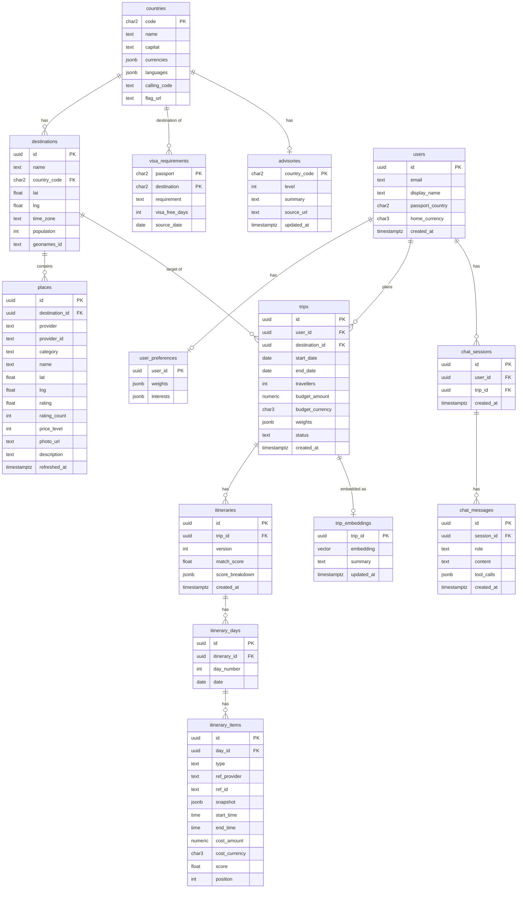

# Database Schema (draft v0.1 — 2026-10-26)

Postgres 17 + pgvector (Neon/Supabase in the cloud, Docker via Aspire locally). Managed with EF Core migrations in `Pamplemousse.Infrastructure/Persistence`.

## Notes
- **Sprint 1 status:** countries, cities and visa rules are bundled files searched in memory ([ADR 0008](../../architecture/adr/0008-sprint-1-config-and-reference-data.md)); these tables are created when saved trips arrive (Sprint 3–4).
- **Seeded reference data:** `countries` (mledoze/countries), `destinations` (GeoNames `cities15000` — free, CC BY, gives free city search without Google), `visa_requirements` (Passport Index), `advisories` (US State Dept, refreshed daily).
- **Cached, not stored:** weather, exchange rates, holidays, events and all price offers go to Redis.
- `places` stores provider data with `refreshed_at`; Google Places terms limit how long some fields may be stored — keep only IDs + refresh, check terms before storing photos/ratings long term.
- `itinerary_items.snapshot` keeps a copy of the chosen offer at save time (prices change).
- `trip_embeddings.embedding`: `vector(768)` — Gemini embeddings truncated to 768 dimensions (configurable).
