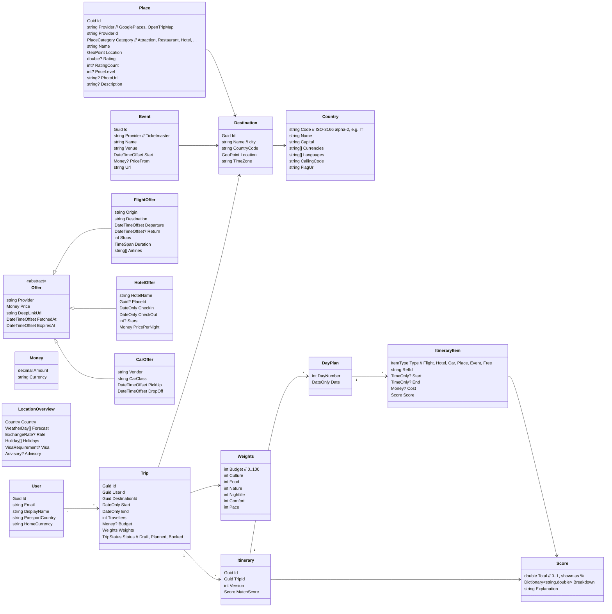

# Domain Model (draft v0.1 — 2026-10-26)

Lives in `Pamplemousse.Domain`. Pure C#, no I/O. Mermaid renders in VS Code, GitHub and Notion.

## Notes
- **Offers are never stored in Postgres** — they live in Redis with an expiry (~1 h). Only the chosen offer is copied into an `ItineraryItem` when a plan is saved.
- **Scoring:** each criterion is normalised to 0..1 per candidate, multiplied by the user's weight, summed, divided by total weight → `Score.Total`. `Breakdown` keeps each criterion's contribution so the app can explain "96% match".
- `Weights` defaults come from the user's saved preferences; a trip can override them.
- **As built (Sprint 4):** the trip, itinerary, days and items are `TripRequest`, `Plan`, `BuiltPlan`, `PlanDay` and `PlanItem` in `Pamplemousse.Domain/Itinerary`; see [spec 008's data model](../../../specs/008-itinerary/data-model.md).
